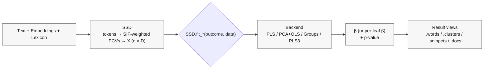

# ssdiff — Architecture

Internals of the `ssdiff` package: module layout, pipeline flow, and how the results layer composes.

For the public API see [`api_reference.md`](api_reference.md).
For the results surface see [`results.md`](results.md).

---

## Top-level pieces

```
SSD                           — one text; builds its document vectors once, dispatches to backends
  ├── .with_lexicon()  → SSD                 (same tokens, another lexicon)
  ├── .fit_pls()       → PLSResult           (ContinuousResult → _SingleResult → Result)
  │                         └── dict[str, _PLSComponentResult]  (ssd_gradients > 1 only,
  │                                                              keys "dim-1" … "dim-N")
  ├── .fit_regression() → PCAOLSResult       (one text term)
  │                     → RegressionResult   (_MultiContainer → Result; several text terms)
  │                         └── dict[term, PCAOLSResult]        (keys "ssd(essay)", "sexM:ssd(essay)")
  ├── .fit_groups()    → GroupResult         (_MultiContainer → Result)
  │                         └── dict[(g1, g2), PairResult]       (_SingleResult leaves)
  ├── .fit_multipls()  → MultiPLSResult      (_MultiContainer → Result)   — PLS3, several outcomes
  │                         └── dict[str, _PLSComponentResult]  (_SingleResult leaves,
  │                                                              keys "dim-1" … "dim-N")
  └── .suggest_lexicon() / .evaluate_lexicon() → LexiconResult

fit_regression(formula, data, **texts) → RegressionResult   — several SSDs in one formula
contrast(g1, g2, embeddings)           → ContrastResult     — two gradients, no fit

Embeddings                    — word-vector store + normalization, no gensim dep;
                                a wordpack also carries the tokenizer and stopwords
```

Composition, not inheritance — `SSD.__init__` only tokenizes the text. Document vectors are built on first use and cached. An `SSD` has no outcome: each `fit_*` takes its own, resolves it to the rows it uses, and returns its own immutable result object. Several backends and outcomes can run on the same `SSD` without rebuilding the vectors.

Result classes compose the same way: one **leaf** base (`_SingleResult`, "one gradient direction + its derived views") and one **container** base (`_MultiContainer`, "dict of leaves + shared test"). `PairResult` is a leaf plugged into `GroupResult`; the same `_SingleResult` code path renders `.words` / `.clusters` / `.snippets` whether it lives standalone as a `ContinuousResult` or nested as a `PairResult`. See [§ Leaf + container bases](#leaf--container-bases).

---

## Module layout

```
ssdiff/
├── __init__.py        — public exports
├── ssd.py             — SSD class (tokenization, doc-vector construction, fit dispatchers, lexicon helpers) and the module-level fit_regression
├── embeddings.py      — Embeddings class (load / normalize / save / lookup)
├── lang_config.py     — wordpack tags
├── py.typed           — PEP 561 marker
├── backends/
│   ├── pls.py         — pls1_rotate, pls3_rotate, word_target — varimax rotation of PLS1 / PLS3 weights, dimension reordering, sign convention
│   ├── pca_sweep.py   — PCA + OLS; joint interpretability/stability sweep
│   ├── _sweep_math.py — sweep scoring primitives
│   ├── regression.py  — ssd(...) formula terms: placeholders, null formulas, coefficient grouping
│   └── group.py       — unified permutation test (omnibus + pairwise)
├── results/
│   ├── __init__.py       — public result exports
│   ├── core.py           — Result ABC, View / ScalarView / TestView, save()/to_* helpers, parameter-keyed cache, attach()
│   ├── single_result.py      — _SingleResult: key-agnostic leaf base — one (β, gradient) + lazy .words/.clusters/.snippets
│   ├── multi_container.py    — _MultiContainer: dict-of-leaves base + _ShimView aggregate wrappers
│   ├── schema.py         — frozen dataclasses: Word, Cluster, ClusterWord, Snippet, Doc, Pair, Outcome, Suggestion, TermTest, Stats, FitInfo, Summary
│   ├── continuous_result.py  — ContinuousResult (_SingleResult subclass), PLSResult, PCAOLSResult, RegressionResult (container), and their views
│   ├── contrast_result.py    — ContrastResult (_SingleResult leaf without documents), contrast()
│   ├── group_result.py       — GroupResult (_MultiContainer), PairResult (_SingleResult leaf), PairsListView, GroupStatsView, GroupTestView
│   ├── multi_pls_result.py   — MultiPLSResult (_MultiContainer), _PLSComponentResult (leaf, shared with PLSResult), MultiPLSStatsView, PLSInfoView, OutcomesView, MultiPLSTestView
│   ├── paired_view.py        — ``_paired_save`` helper: unified multi-key save dispatch used by ``_ShimView``
│   ├── lexicon_result.py     — LexiconResult + lexicon views
│   ├── page.py               — results page: result → JSON (report format 2) → self-contained HTML (page_template.html)
│   ├── report.py             — Report / Section builders + text/md/html/tex/docx/json renderers
│   ├── format.py             — APA-style numeric formatting primitives (fmt_p, fmt_r, fmt_table, …)
│   └── display.py            — set_repr_hints, DEFAULT_COLS registry, DEFAULT_MAX_ROWS
├── utils/
│   ├── math.py         — standardize, pca_fit_transform, KMeans, f_sf / t_sf / chi2_sf (pure numpy)
│   ├── text.py         — wordpack tokenization, PreprocessedDoc dataclass
│   ├── vectors.py      — SIF-weighted doc-vector construction
│   ├── neighbors.py    — filtered nearest-neighbor lookup + cluster_top_neighbors
│   ├── snippets.py     — snippets_along_beta (context-window extraction)
│   ├── lexicon.py      — ranking helpers behind `SSD.suggest_lexicon` / `evaluate_lexicon`
│   └── diagnostics.py  — progress_hook, runtime counters
└── wordpack/
    ├── reader.py       — WordPack: opens a .wordpack file, tokenizes, reads rows
    └── fetch.py        — downloads a pack by full name into the cache
```

Core runtime deps: **numpy + plskit + glmm**. Gensim is optional (only to write `.kv`; loading `.kv` works via an internal unpickler shim). Matplotlib / pandas / openpyxl / python-docx are behind the `[results]` extra and gated at call sites.

---

## Pipeline flow

### Construction

```
Embeddings + texts + lexicon
        │
        ▼
   SSD.__init__()
        │
        ├─ strings → wordpack tokenizer + stopwords → docs, pre_docs (sentences, for snippets)
        │  token lists → docs as given (pre_docs = None)
        └─ store: docs, lexicon, window, sif_a, use_full_doc, name, tokenizer

   first fit (or n_kept) → SSD._vectors(), cached:
        ├─ compute global SIF weights (word_freq / total_tokens) over all documents
        ├─ seed mode: per-doc = mean of SIF-weighted context-window vectors
        │   (full-doc mode when use_full_doc=True: SIF over all tokens)
        └─ L2-normalize rows → X (n_with_vector × D), has_vector (n)
```

No fitting runs at construction. The text knows no outcome. A fit resolves its outcome (values, a column of `data`, or the left side of a formula) and keeps the documents with a valid outcome and a vector. `with_lexicon` copies the SSD with the same tokens and an empty cache.

### `fit_pls()`

```
X (n_kept × D), outcome y (n_kept)
        │
        ├─ formula → residualize y and each column of X on its fixed effects
        │    (one glmm OLS fit per column); everything below runs on the residuals
        ├─ standardize X  (columns, ddof=0)
        ├─ k="auto" → K-selection (plskit.pls1_find_k_optimal):
        │    selector "r2_se" picks K*, with a split_nb diagnostic chain
        ├─ NIPALS PLS1 (plskit.pls1_fit):
        │    for each component:
        │      w = X'y / ‖X'y‖
        │      t = Xw           (score)
        │      p = X't / t't    (loading)
        │      q = y't / t't    (y-loading)
        │      deflate X and y
        ├─ β = W (P'W)⁻¹ Q
        ├─ unscale: β / X_scale
        ├─ orient β: flip if corr(ŷ, y) < 0
        ├─ p-value: plskit.pls1_confirmatory_test(auto) at the fitted k
        │    (k="auto": at k=1)
        └─ ssd_gradients = N > 1 → N gradients, independent of everything above:
             plskit.pls1_fit(Xs, ys, k=N) → W (D × N, orthonormal)
             backends.pls.pls1_rotate(W, Xs, ys, rotate, L):
               rotate="words" → varimax against L = projection of the leading
                                50,000 vocabulary rows onto W; reorder by
                                |corr(Xs W_rot_i, ys)|, descending; flip so it is positive
               rotate=None    → W in NIPALS order and signs
             leaves "dim-1", …, "dim-N": β_i = W_rot[:, i] / X_scale
                                │
                                ▼
                          PLSResult
```

### `fit_regression()`

```
X (n_kept × D) per text, y (n_kept), data
        │
        ├─ formula: add "+ ssd()" if no ssd(...) term; each ssd(name) → placeholder variable
        ├─ keep documents with a valid outcome and a vector in every text
        ├─ per text:
        │    standardize X  (columns, ddof=0)
        │    if fixed_k given → K = fixed_k; else:
        │      PCA sweep K=k_min..k_max, step=k_step
        │      for each K:
        │        PCA(K) → Z → OLS → β
        │        cluster both β-poles → coherence
        │        track stability as 1 − cos(β, β_prev)
        │      score each K:
        │        interp = detrend coherence by var%
        │        stab   = −Δβ
        │        joint  = 0.5 · (AUC_interp + AUC_stab)
        │      → best_k
        │    PCA(K) → Z, scores as _ssd_pca_1 … _ssd_pca_K  (_ssd_<name>_pca_i with several texts)
        ├─ glmm.term_labels(formula with placeholders) → null formula without the text terms
        ├─ glmm.compare(data + Z + _ssd_y, null formula, full formula with each placeholder
        │      expanded to (_ssd_pca_1 + … + _ssd_pca_K))
        │      → F-test (OLS) or likelihood-ratio test; fit1 = result.model
        ├─ several texts: one more compare per text (full vs. formula without that text's terms)
        ├─ more than one label per text: fit.contrast_test on that term's coefficients
        │      → one Wald test per term
        ├─ group coefficient names by text term; per term:
        │      w_K = the term's component coefficients  (÷ sd(y) for Gaussian identity link)
        │      β = V_K w_K / X_scale    (back-project; no sign flip)
        └─ one term → PCAOLSResult; several terms → RegressionResult of PCAOLSResult leaves;
           several texts → RegressionResult keyed by text
```

All text terms of one text share one PCA basis, so their gradients add. Null formulas come from the formula's term labels; `*` is never expanded in ssdiff.

### `fit_multipls()`

```
X (n_kept × D), outcomes Y (n_kept × q), ssd.embeddings
        │
        ├─ standardize X and Y
        ├─ plskit.pls3_fit(Xs, Ys, k=ssd_gradients) → U (D × k), V (q × k), σ (k)
        │    (raise if plskit keeps fewer than k components)
        ├─ rotation target L:
        │    rotate="words"    → L = projection of the leading 50,000 vocabulary rows onto U
        │    rotate="outcomes" → L = V, or one row per outcome group (mean of the
        │                        group's V rows) plus one row per ungrouped outcome
        ├─ backends.pls.pls3_rotate(U, V, σ, rotate, L):
        │    plskit.rotate("varimax", L) → one k × k orthogonal R   (identity if rotate=None;
        │    R = V' without varimax for rotate="outcomes" at k = q with no groups)
        │    U_rot = U R,  V_rot = V R
        │    rotated modes: reorder dimensions by c_i = (R' Σ² R)_ii, descending
        │    every mode: flip signs so the largest |V_rot| entry per dimension is positive
        ├─ cov_explained = Σσ² / ‖Xs'Ys‖²_F
        ├─ LV1 p-value: plskit.pls3_confirmatory_test(auto) on Xs, Ys
        └─ wrap into MultiPLSResult with leaves "dim-1", …, "dim-k":
             direction β_i = U_rot[:, i] / X_scale     (raw doc-vector space)
             .outcomes     = V_rot[:, i] (+ group mean rows)
             .stats        = cov_share = c_i / Σσ², score_corr
                │
                ▼
          MultiPLSResult
```

### `fit_groups()`

```
X (n_kept × D), labels (or a continuous outcome if median_split=True)
        │
        ├─ (optional) median-split y into "low" / "high"
        ├─ filter_small_groups (n < 20 dropped with warning)
        ├─ backends.group.unified_permutation_test:
        │    observed omnibus T = mean pairwise cosine distance between group centroids
        │    for each permutation: shuffle labels, recompute T → null
        │    pairwise: per-contrast T, p_raw, Cohen's d, contrast_norm
        │    correct pairwise p-values (holm / bonferroni / fdr_bh / none)
        └─ build per-contrast sub-view rows:
             words  = nearest neighbors to ±β̂_pair
             clusters, cluster_words = KMeans over neighbors
             snippets = SIF-scored context windows along ±β̂_pair
                │
                ▼
          GroupResult  (keeps x, groups around for gr.test() reruns)
```

---

## Results layer

The results layer is a small set of composable primitives in `results/core.py`, extended by the four concrete result modules.

### `Result` (ABC, in `core.py`)

```python
class Result:
    text: SSD | None
    embeddings: Embeddings | None
    _cache: dict[(str, tuple), View]      # parameter-keyed
    _access: tuple[str, ...]              # repr discoverability — views / methods
    _arrays: tuple[str, ...]              # repr discoverability — numpy arrays

    def attach(texts=None, embeddings=None) -> Self
    def clear_cache(view: str | None = None) -> None
    def _cache_get(name, params, compute) -> View
    def _require_resource(resource, view_name) -> None   # raises with fix hint
    def __repr__(self) / _repr_html_(self)               # summary + access hint + save hint
```

`_access` entries with `(...)` render as methods; bare names render as views. Prefixing every entry with `.` turns the repr into a copy-paste prompt (`result.clusters`, `result.test(...)`).

### Leaf + container bases

Every result is either a **leaf** (one direction in embedding space + its interpretation views) or a **container** (a keyed dict of leaves + one shared test). Two small base classes express this split, and all concrete result classes are built from them.

```
Result                                          (core.py)
 ├─ _SingleResult                               (single_result.py)   — leaf base
 │   ├─ ContinuousResult                        (continuous_result.py)
 │   │   ├─ PLSResult                             — with ssd_gradients > 1 also holds
 │   │   │      self._leaves : dict[str, _PLSComponentResult]   # "dim-1", …, "dim-N"
 │   │   └─ PCAOLSResult                          — also a leaf inside RegressionResult
 │   ├─ PairResult                              (group_result.py — leaf inside GroupResult)
 │   ├─ ContrastResult                          (contrast_result.py — no documents)
 │   └─ _PLSComponentResult                     (multi_pls_result.py — leaf inside MultiPLSResult or PLSResult)
 │
 └─ _MultiContainer                             (multi_container.py) — container base
     ├─ GroupResult                             (group_result.py)
     │   └─ self._leaves : dict[(g1, g2), PairResult]
     ├─ RegressionResult                        (continuous_result.py)
     │   └─ self._leaves : dict[term, PCAOLSResult]    # or dict[text name, PCAOLSResult | RegressionResult]
     └─ MultiPLSResult                          (multi_pls_result.py)
         └─ self._leaves : dict[str, _PLSComponentResult]
                           # keys "dim-1", …, "dim-N"
```

#### `_SingleResult` — the leaf (in `single_result.py`)

Holds **everything derivable from one gradient direction**: `beta`, `gradient = unit(beta)`, `beta_norm`, `x`, `alignment_scores = x · gradient`, plus four lazy views:

| attribute | computes |
|---|---|
| `.words` | nearest neighbors to `±gradient`, filtered by part-of-speech / lexicon |
| `.clusters` | KMeans over top neighbors, per side (`.pos` / `.neg`) |
| `.snippets` | SIF-scored context windows along `±gradient` |
| `.cluster_snippets(side=...)` | snippets grouped by cluster centroid |

**Gated `top_snippet` fill.** `Cluster` rows carry two presentational fields — `top_words` (eager, populated at cluster construction from the per-cluster word list) and `top_snippet` (lazy, **opt-in**). `top_snippet` is *not* in `DEFAULT_COLS`, so default `repr` / `to_dict` / `save` paths never touch it. When the user opts in (`cols="all"` or an explicit cols list including `"top_snippet"`), the `to_dict` / `to_records` / `to_df` / `to_html` / `to_text` / `save` overrides on `ClustersViewSided` call `_ensure_filled_if_requested(keep)`. That guard fires `_fill_top_snippets()` which runs `_cluster_snippets_for(side)` — a one-time SIF + cosine pass across the text — and caches the result on the view instance. The fill is a no-op when `text is None` or `embeddings is None`, leaving `top_snippet=""` and surfacing an `(attach texts to populate)` line in the zoom sub-table. Fill state is per-view-instance: `clear_cache("clusters")` drops the view, and the next opt-in access re-creates and re-fills it; `clear_cache("snippets")` does **not** invalidate already-filled `top_snippet` strings, by design.

**Key-agnostic by design.** `_SingleResult` knows nothing about whether it lives standalone (`ContinuousResult`) or nested inside a container (`PairResult`). It never references a key, a group label, a component index, or a pair. Subclasses plug in their own state — `ContinuousResult` adds `y`, `fit_info`, `.docs`, `.test`; `PairResult` adds `g1 / g2 / contrast` and computes `beta = mean(x[g1]) − mean(x[g2])` from a container-held `x` slice. `ContrastResult` has no `x`: it takes `beta = unit(g1) − unit(g2)` (normalized) and offers only the views that need no documents.

All four views are parameter-keyed in `Result._cache` (e.g. `result.clusters.pos(topn=50)` gets its own cache entry distinct from the default `topn=100`). The base reports "embeddings required for .words" / "text required for .snippets" via `_require_resource()` with a fix hint if `.attach(embeddings=..., texts=...)` hasn't been called.

#### `_MultiContainer` — the container (in `multi_container.py`)

Wraps `self._leaves : dict[Hashable, _SingleResult]` and exposes **aggregate shim views** that fan out across leaves:

| property | yields |
|---|---|
| `container[key]` | the leaf (`_SingleResult`) |
| `container.beta` / `.gradient` / `.beta_norm` / `.alignment_scores` | plain `dict[key, …]` |
| `container.words` / `.clusters` / `.snippets` | `_ShimView` (dict of per-leaf views) |

`_ShimView` is not a tabular view — it's a dict wrapper that supports `shim[key] → leaf view`, a preview repr ("10 pair(s), top 5 per side: …"), and a fan-out `save('words.csv')` that writes one file per key via the shared `_paired_save` helper in `paired_view.py`. Iteration over flat rows is intentionally not supported — each key's leaf view is self-contained, and mixing them would need a `contrast` column that subclasses annotate independently.

**Two small hooks** let subclasses customize key rendering without touching the base:

- `_key_to_str(key) -> str` — filename / sheet / JSON-key form (e.g. `"g1_g2"` for a pair tuple)
- `_key_repr(key) -> str` — human-readable heading (e.g. `"g1 vs g2"`)

The subclass is responsible for: (1) populating `self._leaves`, (2) attaching the **shared** `.stats` and `.test` views (the container owns the one omnibus test; individual leaves don't get independent `.test`), and (3) providing any key validation (`GroupResult.__getitem__` rejects reversed pair tuples with a canonical-order hint).

#### Why this split

Having one leaf code path makes nested views behave identically to standalone ones. `PairResult.words` and `ContinuousResult.words` run the same `_compute_words_rows()`, cache with the same key scheme, and render with the same column defaults. Adding a new multi-result class (e.g. PLS3 with a shared test) means writing one tiny leaf subclass + one tiny container subclass — no changes to the base classes, the cache, the save fan-out, or the renderers.

### `View[T]`, `ScalarView`, `TestView` (in `core.py`)

Every view is a thin iterable over frozen dataclasses that gains a uniform export surface by inheritance:

```
View[T]                  — tabular; __iter__ yields T (a dataclass)
 ├─ ScalarView          — single-row; attribute + __getitem__ access to fields
 │   └─ TestView        — callable; reruns a statistical test, mutates parent
 └─ …                   — WordsView, DocsView, SnippetsView, ClustersViewSided, …
```

Uniform methods defined on `View` / `ScalarView`:

| Method | What it does |
|---|---|
| `to_dict`, `to_records`, `to_df`, `to_html`, `to_text` | in-memory export; `cols=None\|"all"\|sequence` |
| `save(path, *, cols=None, k=None)` | disk export; extension dispatch |
| `_resized(k)` | trim to first k rows (default: slicing) |
| `_save_hint()` / `_save_hint_html()` | one-line repr footer |
| `_default_cols()` | per-class default column subset (looked up via `DEFAULT_COLS`) |

`TestView.__call__(name=None, **params)` dispatches to a subclass-implemented `_run(name, params)`, updates `self._info`, and runs an `_on_rerun()` hook so the parent's `stats.pvalue` stays in sync with `test.pvalue`.

### Parameter-keyed cache

Views computed from parameters live in `Result._cache` keyed by `(view_name, frozen_params)` where `frozen_params = tuple(sorted(params.items()))`. Each distinct parameter set gets its own entry:

```python
result.clusters.pos                # cache key ("clusters", (("side", "pos"), ("topn", 100), …))
result.clusters.pos(topn=50)       # cache key ("clusters", (("side", "pos"), ("topn", 50),  …))
result.clusters.pos                # still hits the topn=100 entry
```

`clear_cache()` drops the whole dict; `clear_cache("clusters")` drops every entry whose first key matches. There is no by-params form by design — users who need that should call the view with the specific params they want to rebuild.

### Column defaults (`results/display.py`)

A single registry maps view **class names** (not `_name`s) to their default column subset:

```python
DEFAULT_COLS: dict[str, tuple[str, ...]] = {
    "WordsView":          ("side", "rank", "word", "cos_beta"),
    "SnippetsView":       ("side", "doc_id", "cosine", "seed", "text_window"),
    "StatsView":          ("backend", "r2", "pvalue", "n_kept", "iqr_effect"),
    "OLSStatsView":       ("backend", "r2", "r2_adj", "pvalue", "n_kept", "iqr_effect"),
    …
}
```

Keying by `__name__` (not `_name`) lets sibling views with the same `_name` — e.g. `StatsView` vs `OLSStatsView` — diverge. Views without an entry fall through to full `_columns` via `View._default_cols()`.

`_validate_cols(cols, view)` in `core.py` resolves `cols=` on every output call: `None → _default_cols()`, `"all" → _columns`, explicit sequence → validated (unknown names warn, dropped).

### Numeric formatting (`results/format.py`)

APA-style primitives used by every renderer:

| helper | behavior |
|---|---|
| `fmt_p(x)` | `<.001` / three decimals (`.007`) — never scientific |
| `fmt_r(x, signed=False)` | two-decimal correlation-scale number |
| `fmt_d(x)` | two-decimal unbounded scalar (Cohen's d, beta norm) |
| `fmt_pct(x)` | percentage |
| `fmt_count(x)` | thousands-separated integer |
| `fmt_cell(v, col)` | dispatch on column name + value type |
| `fmt_table(rows, headers, numeric, …)` | aligned plain-text table (used by every `to_text`) |

Consistent formatting means repr, `to_text`, `to_html`, markdown, and LaTeX outputs all show p-values as `.007` (never `7.3e-03`) and correlations to two decimals.

### Report builder (`results/report.py`)

A `Report` is a multi-section builder (title + optional subtitle + list of `Section`s). Three `Section.kind`s:

| kind | row shape | rendered as |
|---|---|---|
| `"kv"` | `list[(key, value)]` | 2-col table (terminal), `<table class="kv">` (HTML), `| Metric | Value |` (MD), `\begin{tabular}{ll}` (TeX) |
| `"table"` | `list[list]` + headers | multi-col table in every format |
| `"list"` | `list[str]` | bullet list |

`Report.save(path)` dispatches on extension: `.md .txt .html .tex .docx .json`.

---

## Pipeline flow diagram



The backend box covers all four fit methods — each has its own file in `backends/` and its own result class, but they share the same upstream (PCV construction) and downstream (result-view) machinery. See the per-backend subsections above for the internal step sequences.

---

## Significance testing

### `fit_regression()` — F-test or likelihood-ratio test, and Wald tests per term

`glmm.compare` fits the formula without its text terms and the full formula (each text term replaced by its K components) by ML on the same rows, and tests the text terms together. An OLS model (Gaussian, no random effects) gives the analytic F-test (with no formula, the same as OLS in PCA space), and so do Gamma and inverse-Gaussian GLMs (Wald F); every other model gives the likelihood-ratio test. Returned as `result.stats.pvalue` and echoed on `result.test` (`"f_test"` or `"lrt"`).

With several texts there is one more comparison for each text: the full formula against the formula without that text's terms. A text with more than one term also gets one Wald test per term label (`Fit.contrast_test` on that term's coefficients, `"wald_f"` or `"wald_chisq"`), so lower-order terms are tested too. All rows go into one table, `result.test` on the `RegressionResult`. The null formulas come from `glmm.term_labels`, never from expanding `*` in ssdiff.

### `fit_pls()` — plskit `test_method="auto"`

`plskit.pls1_confirmatory_test` with its default `test_method="auto"`: repeated train/test splits, calibrated against a permutation null (`split_exact`) or by an asymptotic correction (`split_nb`). plskit picks the method from X alone and reports it in `result.test_method`, which becomes `result.test.name`. It runs at the fitted `k` (at k=1 when `k="auto"`). `split_nb` is used only in the diagnostic chain that picks `k`.

With a formula the test sees the residualized y and X, so `split_exact` permutes residuals against residuals (Kennedy, 1995). The residualized arrays are kept in the result's raw diagnostics (`x_resid`, `y_resid`) so a rerun tests the same data.

`result.test(n_splits=..., seed=...)` reruns it; `PLSTestView` always runs `"auto"` and raises `TypeError` for any name other than `"auto"` or the stored method. `result.stats.pvalue` is propagated by the `_on_rerun` hook.

The `ssd_gradients` leaves carry no p-value; the test is the standard fit's.

### `fit_multipls()` — plskit `test_method="auto"` at LV1

`plskit.pls3_confirmatory_test` with its default `test_method="auto"` (`split_exact` or `split_nb`, chosen from X alone) tests the first latent variable only, on the standardized data. The statistic is the held-out LV1 correlation. The p-value does not depend on `rotate`, so it lives on the container; leaves carry none. `result.test(n_splits=..., n_perm=..., seed=...)` reruns it on the raw `x` and `y`.

### `fit_groups()` — permutation omnibus + pairwise

Observed omnibus statistic: mean pairwise cosine distance between group centroids. Null: shuffle group labels `n_perm` times. Pairwise contrasts get their own permutation p-values with multiple-comparison correction (Holm, Bonferroni, FDR-BH, or none).

---

## Pure-numpy math (`utils/math.py`)

`ssdiff` avoids scipy/scikit-learn at runtime. Primitives implemented from scratch:

- `standardize(X)` — z-score with `ddof=0` (matches sklearn's `StandardScaler`).
- `pca_fit_transform(X, n_components)` — SVD-based PCA returning components + explained variance.
- `kmeans(X, k)` — used for cluster_top_neighbors.
- `f_sf / t_sf / chi2_sf` — survival functions for analytic tests.

This keeps the wheel slim and avoids pinning transitive scipy / scikit-learn versions.

---

## See also

- [`api_reference.md`](api_reference.md) — user-facing API.
- [`results.md`](results.md) — results surface (views, reports, cache, reruns).
- [`results_tables.md`](results_tables.md) — per-view column listings and defaults.
